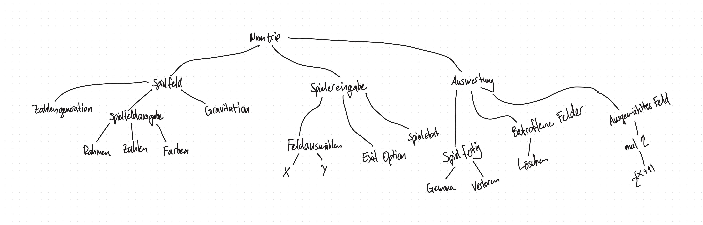

Stand(20.11.2026)

Mit dem User Input habe ich die x, y und Feldauswahl programmiert. Zudem eine Pseudo Auswertung bei dem das Betroffene Feld leer wird.

Der Code kann noch nicht einschätzen, ob der Input 'Sinn' ergibt bzw. weiter auswertbar ist. Mein Programm vertraut heute noch darauf, dass der User mit ihm und nicht gegen ihn aggiert.

Die Spielereingabe wird vom Gameloop ausgeführt.